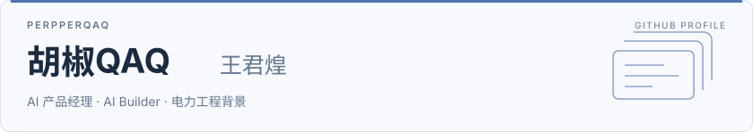

<a href="https://perpperqaq.github.io/moontide-demo/">
<picture>
  <source media="(prefers-color-scheme: dark) and (max-width: 600px)" srcset="assets/profile-dark-mobile.svg" />
  <source media="(max-width: 600px)" srcset="assets/profile-light-mobile.svg" />
  <source media="(prefers-color-scheme: dark)" srcset="assets/profile-dark.svg" />
  
</picture>
</a>

<a href="https://perpperqaq.github.io/moontide-demo/"><picture><source media="(prefers-color-scheme: dark)" srcset="assets/nav-website-dark.svg" /></picture></a>
<a href="#项目"><picture><source media="(prefers-color-scheme: dark)" srcset="assets/nav-projects-dark.svg" /></picture></a>
<a href="#公众号文章"><picture><source media="(prefers-color-scheme: dark)" srcset="assets/nav-writing-dark.svg" /></picture></a>
<a href="mailto:1041415195@qq.com"><picture><source media="(prefers-color-scheme: dark)" srcset="assets/nav-contact-dark.svg" /></picture></a>

## 项目

<table width="100%">
<tr>
<td width="50%" valign="top">
<h4> <a href="https://github.com/PerpperQAQ/AIPM-QAQPM-Skills">QAQPM Skills</a></h4>

面向 AI 产品经理的工作流，覆盖问题定义、调研、评测、PRD、开发验收与上线观察。

<code>产品流程</code> <code>Agent Skill</code>

<a href="https://github.com/PerpperQAQ/AIPM-QAQPM-Skills">源码</a>

</td>
<td width="50%" valign="top">
<h4> <a href="https://github.com/PerpperQAQ/video-transcript">视频转录与总结</a></h4>

将抖音、B 站视频整理成文字、时间轴与结构化总结，支持 Markdown 归档。

<code>ASR</code> <code>内容处理</code>

<a href="https://github.com/PerpperQAQ/video-transcript">源码</a> · <a href="https://perpperqaq.github.io/video-transcript/">在线查看 ↗</a>

</td>
</tr>
<tr>
<td width="50%" valign="top">
<h4> <a href="https://github.com/PerpperQAQ/vibe-coding-review">AI 编程复盘</a></h4>

复盘 AI 辅助开发中的需求、架构、调试与验收，整理重复问题与下次可复用的约束。

<code>AI 协作</code> <code>复盘</code>

<a href="https://github.com/PerpperQAQ/vibe-coding-review">源码</a>

</td>
<td width="50%" valign="top">
<h4> <a href="https://github.com/PerpperQAQ/amadeus-resonance-promo-site">Amadeus 展示页</a></h4>

AI 陪伴项目的宣传与交互展示页，包含人物与世界线切换；未接入真实对话。

<code>交互展示</code> <code>前端原型</code>

<a href="https://github.com/PerpperQAQ/amadeus-resonance-promo-site">源码</a> · <a href="https://perpperqaq.github.io/amadeus-resonance-promo-site/">在线查看 ↗</a>

</td>
</tr>
<tr>
<td width="50%" valign="top">
<h4> <a href="https://github.com/PerpperQAQ/moontide-demo">个人展示站</a></h4>

展示个人经历、能力与项目的交互网站，包含联系入口，采用蓝白斜切的视觉风格。

<code>个人作品集</code> <code>Web</code>

<a href="https://github.com/PerpperQAQ/moontide-demo">源码</a> · <a href="https://perpperqaq.github.io/moontide-demo/">在线查看 ↗</a>

</td>
<td width="50%" valign="top">
<h4> <a href="https://github.com/PerpperQAQ/cd-vocablearn-cs">计算机词汇学习</a></h4>

计算机科学英语词汇学习，提供听写、听力、搜索与互动测验，并保存学习进度。

<code>学习工具</code> <code>JavaScript</code>

<a href="https://github.com/PerpperQAQ/cd-vocablearn-cs">源码</a>

</td>
</tr>
</table>

Fork：<a href="https://github.com/PerpperQAQ/rea">REA</a>（Agent 逆向分析，源自 <a href="https://github.com/morluto/rea">morluto/rea</a>） · <a href="https://github.com/PerpperQAQ/Unlock-NetEaseMusic-II">Unlock NetEaseMusic</a>（音乐相关自动化，源自 <a href="https://github.com/axxshen/Unlock-NetEaseMusic-II">axxshen</a>）

## 技能

**产品**　`问题定义` `需求拆解` `竞品分析` `PRD` `评测设计`

**AI / Agent**　`Skill 设计` `工作流编排` `提示词设计` `ASR`

**实践**　`AI 辅助开发` `前端原型` `Python` `JavaScript`

## 公众号文章

公众号 **「胡椒QAQ」**

- **[DeepSeek Super-agent 原型解读](https://mp.weixin.qq.com/s/64B6V75BQfNWOAr-_YNjeg)** 2026.11.01 · 接单、授权、执行与中断恢复
- **[Claude 系统卡中的「模型福祉」](https://mp.weixin.qq.com/s/wikaX4YE7bLKQqdjpejwnQ)** 2026.10.26 · 状态评估、偏好表达与同意边界
- **[个人 Agent 的能力与分寸](https://mp.weixin.qq.com/s/NkbFtkUk6dLQq_WGbOy9hg)** 2026.10.23 · 记忆机制、用户信任与评测

[全部文章 →](ARTICLES.md)
